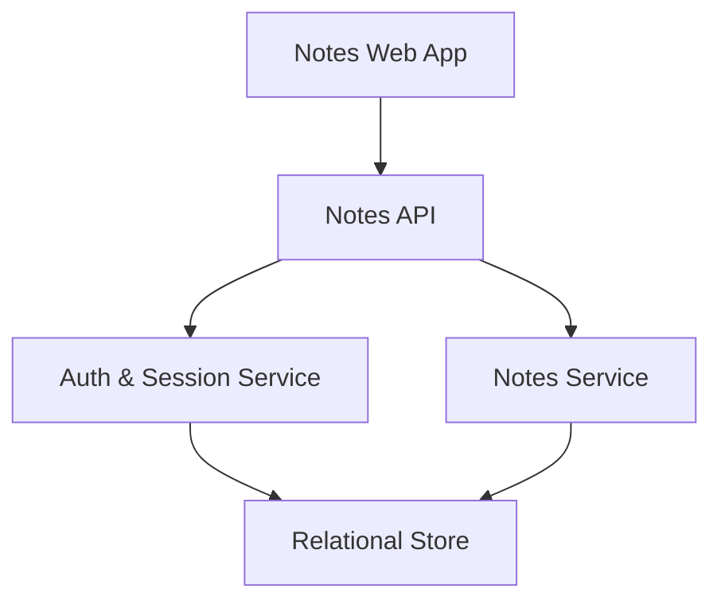
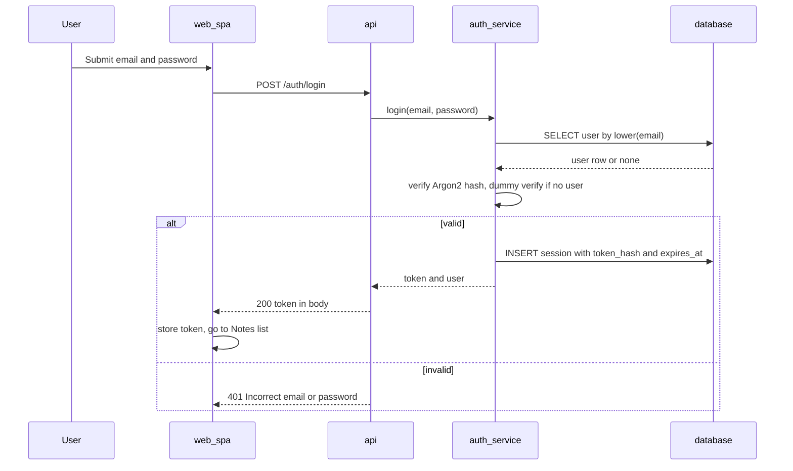
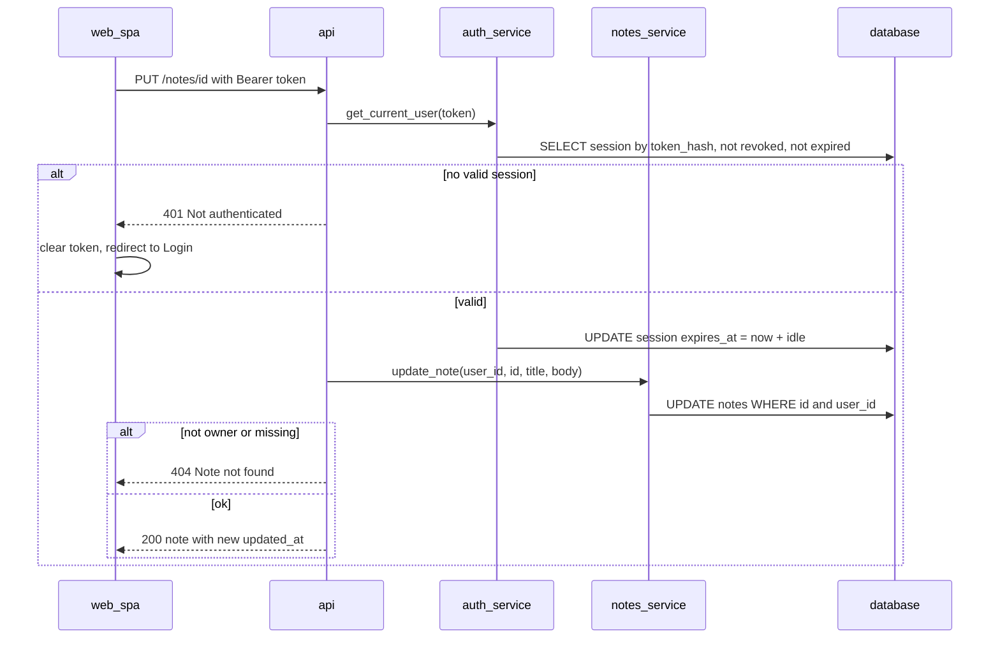
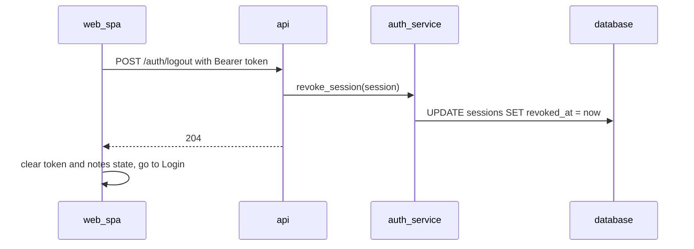
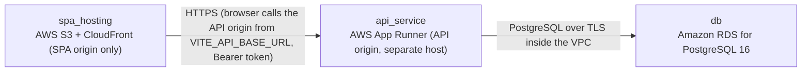

# Architecture

> Maintained by QuorQ AI SDLC. Text between `sdlc:auto` markers is regenerated; anything outside them is yours and is kept.

<!-- sdlc:auto:start narrative -->
## Overview

### ARCH-001 · approved · source: architecture:v1

Approved Version 1 architecture for a small Personal Notes web app. It has two parts: a React 19 SPA (Login, Notes list, Note editor) and a FastAPI 0.115 API backed by PostgreSQL 16 on AWS. The SPA and the API sit on different origins, so auth uses server-side sessions with opaque bearer tokens.

- Status: approved; Version: 1.
- Frontend: React 19 single-page app with three screens:
  - Login, with a sign-in/sign-up toggle.
  - Notes list.
  - Note editor.
- Backend: FastAPI 0.115 API for accounts, sessions and notes.
- Storage: PostgreSQL 16 on AWS.
- The web app and the API are served from different web addresses (origins).
- Session approach:
  - Sign-in uses server-side sessions with an opaque bearer token.
  - The login response returns the token in its body.
  - The SPA sends it as `Authorization: Bearer <token>`.
  - The server can revoke the token on sign-out or when it expires from inactivity.
- Passwords are stored as Argon2 salted hashes.
- Every notes query is scoped to the signed-in user, so other users' notes return 404.
- Notes are plain text and are rendered only as text.
- No external services or API keys are required.

**Related:** ARCH-010, ARCH-011, ARCH-012, ARCH-013, ARCH-014, ARCH-030, ARCH-040, ARCH-050, ARCH-060

### ARCH-010 · approved · source: architecture:component:web_spa

Notes Web App (React 19): the browser client. It provides the Login, Notes list and Note editor screens and manages the bearer token on the client side.

Responsibilities:
- Provides the Login screen (with sign-in/sign-up toggle), the Notes list screen and the Note editor screen.
- Uses a responsive layout.
- Stores the session token and attaches it as a Bearer header on every API call.
- Redirects to Login on any 401 response.
- Renders note content only as React text nodes.
- Keeps unsaved editor text when a save fails.

Related technology detail (see ARCH-061):
- Vite-built TypeScript SPA with three routes.
- Mobile-first responsive layout in plain CSS.
- An auth context holds the token in localStorage.

**Related:** ARCH-001, ARCH-031, ARCH-032, ARCH-033, ARCH-061, AC-007, AC-028

### ARCH-011 · approved · source: architecture:component:api

Notes API (FastAPI 0.115): the HTTP surface for auth and notes. It validates input, returns generic error messages and allows CORS from the SPA origin.

Responsibilities:
- Provides HTTP endpoints for:
  - register
  - login
  - logout
  - the current user
  - notes CRUD
- Validates input.
- Maps errors to generic JSON messages that expose no internals.
- Allows CORS from the SPA origin.

The SPA and the API run on separate origins, which is why CORS is required.

**Related:** ARCH-001, ARCH-012, ARCH-013, ARCH-040, ARCH-062

### ARCH-012 · approved · source: architecture:component:auth_service

Auth & Session Service (FastAPI 0.115): handles credentials and sessions. It hashes passwords with Argon2, issues opaque tokens stored only as SHA-256 hashes, applies sliding inactivity expiry, revokes sessions on logout and provides the current-user dependency.

Responsibilities:
- Normalises email to lowercase.
- Hashes and verifies passwords with Argon2.
- Returns a generic failure message on bad credentials.
- Issues opaque random session tokens and stores only their SHA-256 hash.
- Applies a sliding inactivity expiry, configured by SESSION_IDLE_MINUTES (see ARCH-032).
- Revokes sessions on logout.
- Provides the current-user dependency (get_current_user) used by every notes route.

**Related:** ARCH-001, ARCH-011, ARCH-014, ARCH-030, ARCH-031, ARCH-032, ARCH-033, NFR-004, AC-002, AC-011

### ARCH-013 · approved · source: architecture:component:notes_service

Notes Service (FastAPI 0.115): note CRUD, always filtered by the owner's user_id. Note lists are ordered by updated_at, newest first.

Responsibilities:
- Creates, reads, updates and deletes notes.
- Every operation is filtered by the owner's user_id, so another user's note returns 404.
- Lists notes ordered by updated_at descending.

**Related:** ARCH-001, ARCH-011, ARCH-014, ARCH-032, AC-013, AC-027, AC-035

### ARCH-014 · approved · source: architecture:component:database

Relational Store (PostgreSQL 16): persists users, notes and sessions. It enforces unique lowercase email and requires exactly one owner per note.

Responsibilities:
- Persists users, notes and sessions.
- Enforces unique lowercase email.
- Requires every note to have exactly one owner through a NOT NULL foreign key to users.

Per the Database technology decision (ARCH-063):
- A composite index serves the notes list query.
- Unique and foreign-key constraints enforce data integrity (NFR-011).

**Related:** ARCH-001, ARCH-030, ARCH-053, ARCH-063, NFR-011

### ARCH-030 · approved · source: architecture:entities

Data model with three entities: users, notes and sessions. Notes and sessions both reference a user.

users:
- id
- email (unique, lowercase)
- password_hash (Argon2)
- created_at

notes:
- id
- user_id (NOT NULL foreign key to users)
- title
- body
- created_at
- updated_at

sessions:
- id
- user_id
- token_hash (SHA-256 of the opaque token)
- created_at
- expires_at (sliding)
- revoked_at

**Related:** ARCH-012, ARCH-013, ARCH-014

### ARCH-031 · approved · source: architecture:critical_path:register_or_sign_in

Critical path: register or sign in. Both flows end by issuing a session token. Email normalisation catches duplicate accounts in any letter case, and bad credentials return one generic 401.

- Register (AC-001..AC-003) ends by issuing a session token.
- Login (AC-005, AC-006) ends by issuing a session token.
- Email is normalised to lowercase, so duplicate registrations are caught in any letter case (AC-002).
- An unknown email and a wrong password both return the same 401 'Incorrect email or password' (NFR-004).

**Related:** ARCH-012, ARCH-041, ARCH-042, AC-001, AC-002, AC-003, AC-005, AC-006, NFR-004

### ARCH-032 · approved · source: architecture:critical_path:authenticated_note_request

Critical path: authenticated note request with sliding expiry. Every notes call validates the bearer token and extends the session. Queries are owner-scoped, and the SPA handles 401 by returning to Login.

1. Every notes call runs the get_current_user dependency.
2. The dependency hashes the bearer token.
3. It loads a session that is neither revoked nor expired.
4. It extends expires_at by SESSION_IDLE_MINUTES, giving a sliding expiry (AC-011).
5. Notes queries always filter by user_id, so another user's note returns 404 (AC-027).
6. On a 401, the SPA clears the token and routes to Login (AC-007, AC-028).

**Related:** ARCH-010, ARCH-012, ARCH-013, AC-007, AC-011, AC-027, AC-028

### ARCH-033 · approved · source: architecture:critical_path:sign_out

Critical path: sign out. Logout revokes the session on the server, so the token cannot be reused. The SPA discards the token and its cached notes, so the Back button shows no notes.

- Logout sets revoked_at on the session.
- Any reuse of the token then returns 401 (AC-009, AC-012).
- The SPA discards the token and its cached notes.
- Protected routes redirect to Login, so pressing Back after sign-out shows no notes.

**Related:** ARCH-010, ARCH-012, ARCH-043, AC-009, AC-012

### ARCH-040 · approved · source: architecture:endpoints

API endpoint catalogue: 10 endpoints covering auth (4), notes CRUD (5) and a health check (1).

Auth:
- POST /auth/register
- POST /auth/login
- POST /auth/logout
- GET /auth/me

Notes:
- GET /notes
- POST /notes
- GET /notes/{id}
- PUT /notes/{id}
- DELETE /notes/{id}

Health:
- GET /health

See ARCH-041..ARCH-050 for each endpoint.

**Related:** ARCH-011, ARCH-041, ARCH-042, ARCH-043, ARCH-044, ARCH-045, ARCH-046, ARCH-047, ARCH-048, ARCH-049, ARCH-050

### ARCH-041 · approved · source: architecture:endpoint:POST /auth/register

POST /auth/register creates an account and signs the new user in.

- Purpose: create an account and sign in.
- Covers: AC-001..AC-003.

**Related:** ARCH-031, AC-001, AC-002, AC-003

### ARCH-042 · approved · source: architecture:endpoint:POST /auth/login

POST /auth/login signs the user in and returns the session token in the response body.

- Purpose: sign in.
- Covers: AC-005, AC-006.
- Returns the opaque session token in the response body (per the overview).

**Related:** ARCH-031, AC-005, AC-006

### ARCH-043 · approved · source: architecture:endpoint:POST /auth/logout

POST /auth/logout revokes the current session.

- Purpose: revoke the current session by setting revoked_at.
- Covers: AC-009, AC-012.

**Related:** ARCH-033, AC-009, AC-012

### ARCH-044 · approved · source: architecture:endpoint:GET /auth/me

GET /auth/me returns the current user. The SPA calls it on load to check the session.

- Purpose: return the current user.
- The SPA uses it to check the session on load.
- The input cites no AC ids for this endpoint.

**Related:** ARCH-010, ARCH-012

### ARCH-045 · approved · source: architecture:endpoint:GET /notes

GET /notes lists the signed-in user's own notes, most recently updated first.

- Purpose: list own notes, ordered by updated_at descending.
- Covers: AC-013, AC-035.

**Related:** ARCH-013, AC-013, AC-035

### ARCH-046 · approved · source: architecture:endpoint:POST /notes

POST /notes creates a note.

- Purpose: create a note with a title and body.
- Covers: AC-017, AC-018.

**Related:** ARCH-013, AC-017, AC-018

### ARCH-047 · approved · source: architecture:endpoint:GET /notes/{id}

GET /notes/{id} returns one of the user's own notes.

- Purpose: get one own note.
- Owner-scoped, so another user's note returns 404 (per ARCH-032).
- The input cites no AC ids for this endpoint.

**Related:** ARCH-013, ARCH-032

### ARCH-048 · approved · source: architecture:endpoint:PUT /notes/{id}

PUT /notes/{id} updates the title and body of one of the user's own notes.

- Purpose: update the title and body of an own note.
- Covers: AC-020, AC-021.

**Related:** ARCH-013, AC-020, AC-021

### ARCH-049 · approved · source: architecture:endpoint:DELETE /notes/{id}

DELETE /notes/{id} permanently deletes one of the user's own notes.

- Purpose: permanently delete an own note.
- Covers: AC-024.

**Related:** ARCH-013, AC-024

### ARCH-050 · approved · source: architecture:endpoint:GET /health

GET /health is a liveness and database check for the hosting platform.

- Purpose: liveness and database check for the host (App Runner).
- The input cites no AC ids for this endpoint.

**Related:** ARCH-052

### ARCH-051 · approved · source: architecture:deployment:spa_hosting

SPA hosting: the static React 19 build is served from AWS S3 and CloudFront on the SPA origin only.

- Platform: AWS S3 + CloudFront (SPA origin only).
- Artifact: static React 19 build.

**Related:** ARCH-010, ARCH-064

### ARCH-052 · approved · source: architecture:deployment:api_service

API service: a Python container running FastAPI 0.115 with uvicorn on AWS App Runner, on a separate host from the SPA.

- Platform: AWS App Runner (API origin, separate host).
- Artifact: Python container running FastAPI 0.115 with uvicorn.

**Related:** ARCH-011, ARCH-012, ARCH-013, ARCH-050, ARCH-064

### ARCH-053 · approved · source: architecture:deployment:db

Database: Amazon RDS for PostgreSQL 16 on db.t4g.micro with encrypted storage.

- Platform: Amazon RDS for PostgreSQL 16.
- Instance class: db.t4g.micro.
- Storage: encrypted.

**Related:** ARCH-014, ARCH-063, ARCH-064

### ARCH-061 · approved · source: architecture:tech_decision:frontend

Frontend decision: React 19, part of the approved stack. Alternatives were Vue and Svelte. It is built as a Vite TypeScript SPA with an auth context that keeps the token in localStorage.

- Choice: React 19 (approved stack).
- Alternatives considered: Vue, Svelte.
- Implementation in this design:
  - Vite-built TypeScript SPA.
  - Three routes.
  - Mobile-first responsive layout in plain CSS.
  - An auth context holds the token in localStorage.
  - The auth context handles 401 by redirecting to Login.

**Related:** ARCH-010, ARCH-051

### ARCH-062 · approved · source: architecture:tech_decision:backend

Backend decision: FastAPI 0.115, part of the approved stack. Alternatives were Django and Express. This entry records a change from the approved rationale: cookie sessions were replaced with opaque bearer tokens because the SPA and the API are on different origins.

- Choice: FastAPI 0.115 (approved stack).
- Alternatives considered: Django, Express.
- Pydantic models provide the validation messages.
- A get_current_user dependency enforces auth on every notes route.

Recorded conflict:
- Approved stack rationale: cookie sessions.
- This architecture: opaque bearer tokens, returned in the login response body and sent as an `Authorization: Bearer` header.
- Stated reason: the SPA and the API are on different origins.
- The input marks this architecture as approved overall. It does not separately state who approved departing from the cookie-session rationale.

**Related:** ARCH-001, ARCH-011, ARCH-012, ARCH-052

### ARCH-063 · approved · source: architecture:tech_decision:database

Database decision: PostgreSQL 16, part of the approved stack. Alternatives were SQLite and MySQL. Constraints enforce data integrity, and a composite index serves the notes list query.

- Choice: PostgreSQL 16 (approved stack).
- Alternatives considered: SQLite, MySQL.
- Holds users, notes and sessions.
- Unique and foreign-key constraints enforce data integrity (NFR-011).
- A composite index serves the notes list query.

**Related:** ARCH-014, ARCH-030, ARCH-053, NFR-011

### ARCH-064 · approved · source: architecture:tech_decision:cloud

Cloud decision: AWS, part of the approved stack. Alternatives were Azure and GCP. S3 and CloudFront host the SPA, App Runner hosts the API and RDS hosts PostgreSQL.

- Choice: AWS (approved stack).
- Alternatives considered: Azure, GCP.
- Hosting:
  - S3 + CloudFront: SPA.
  - App Runner: API container.
  - RDS: PostgreSQL 16.
- Rationale: all services are managed and right-sized for hundreds of users.

**Related:** ARCH-051, ARCH-052, ARCH-053
<!-- sdlc:auto:end narrative -->

<!-- sdlc:auto:start building-blocks -->
## Building Block View

| ID | Name | Technology | Responsibility | Depends on |
|---|---|---|---|---|
| web_spa | Notes Web App | React 19 | Provides the Login (with sign-in/sign-up toggle), Notes list and Note editor screens with a responsive layout. Stores the session token and attaches it as a Bearer header on every call. Redirects to Login on any 401. Renders note content only as React text nodes. Keeps unsaved editor text when a save fails. | api |
| api | Notes API | FastAPI 0.115 | Provides the HTTP API for register, login, logout, the current user, and notes CRUD. Validates input, maps errors to generic JSON messages without internals, and allows CORS from the SPA origin. | auth_service, notes_service |
| auth_service | Auth & Session Service | FastAPI 0.115 | Normalises email to lowercase, hashes and verifies passwords with Argon2 and returns a generic failure message. Issues opaque random session tokens and stores only their SHA-256 hash. Applies a sliding inactivity expiry and revokes sessions on logout. Provides the current-user dependency used by every notes route. | database |
| notes_service | Notes Service | FastAPI 0.115 | Creates, reads, updates and deletes notes, always filtered by owner user_id. Lists notes ordered by updated_at descending. | database |
| database | Relational Store | PostgreSQL 16 | Persists users, notes and sessions. Enforces unique lowercase email and requires every note to have exactly one owner through a NOT NULL foreign key. | — |

<!-- sdlc:auto:end building-blocks -->

<!-- sdlc:auto:start runtime -->
## Runtime View

### Register or sign in

Register (AC-001..003) and login (AC-005, AC-006) both end by issuing a session token. Email is normalised to lowercase so duplicates are caught in any letter case (AC-002). An unknown email or a wrong password returns the same 401 'Incorrect email or password' (NFR-004).

- **Components:** web_spa, api, auth_service, database
- **Modules:** app/routers/auth.py, app/services/auth.py, app/security.py, web/src/pages/LoginPage.tsx, web/src/api/client.ts
- **Key functions:** register(email, password), login(email, password), hash_password(pw), verify_password(hash, pw), create_session(user_id) -> token, normalize_email(email)

### Authenticated note request with sliding expiry

Every notes call runs the get_current_user dependency. It hashes the bearer token and loads a session that is not revoked and not expired, then extends expires_at by SESSION_IDLE_MINUTES (AC-011). Notes queries always filter by user_id, so another user's note returns 404 (AC-027). A 401 makes the SPA clear the token and route to Login (AC-007, AC-028).

- **Components:** web_spa, api, auth_service, notes_service, database
- **Modules:** app/deps.py, app/routers/notes.py, app/services/notes.py, web/src/pages/NotesListPage.tsx, web/src/pages/NoteEditorPage.tsx
- **Key functions:** get_current_user(authorization), touch_session(session), list_notes(user_id), get_note(user_id, note_id), update_note(user_id, note_id, title, body), delete_note(user_id, note_id)

### Sign out

Logout sets revoked_at on the session, so any reuse of the token returns 401 (AC-009, AC-012). The SPA discards the token and its cached notes, and the protected routes redirect to Login, so the Back button shows no notes.

- **Components:** web_spa, api, auth_service, database
- **Modules:** app/routers/auth.py, web/src/auth/AuthContext.tsx
- **Key functions:** logout(session), revoke_session(session_id)

<!-- sdlc:auto:end runtime -->

<!-- sdlc:auto:start deployment-view -->
## Deployment View

| Name | Service | Runtime | Scaling | Environment |
|---|---|---|---|---|
| spa_hosting | AWS S3 + CloudFront (SPA origin only) | Static React 19 build | Managed CDN | dev |
| api_service | AWS App Runner (API origin, separate host) | Python container running FastAPI 0.115 with uvicorn | 1-2 instances, autoscale on concurrency | dev |
| db | Amazon RDS for PostgreSQL 16 | PostgreSQL 16, db.t4g.micro, encrypted storage | Single-AZ, automated backups | dev |

| Source | Target | Protocol |
|---|---|---|
| spa_hosting | api_service | HTTPS (browser calls the API origin from VITE_API_BASE_URL, Bearer token) |
| api_service | db | PostgreSQL over TLS inside the VPC |

<!-- sdlc:auto:end deployment-view -->

<!-- sdlc:auto:start decisions -->
## Architecture Decisions

| Layer | Choice | ADR |
|---|---|---|
| Frontend | React 19 | [ADR-0001](adr/frontend.md) |
| Backend | FastAPI 0.115 | [ADR-0002](adr/backend.md) |
| Database | PostgreSQL 16 | [ADR-0003](adr/database.md) |
| Cloud | AWS | [ADR-0004](adr/cloud.md) |
<!-- sdlc:auto:end decisions -->

<!-- sdlc:auto:start links -->
## Related Documents

- [Data Model](data-model.md)
- [API Specification](api/openapi.yaml)
- [Architecture Decision Records](adr/README.md)
<!-- sdlc:auto:end links -->
