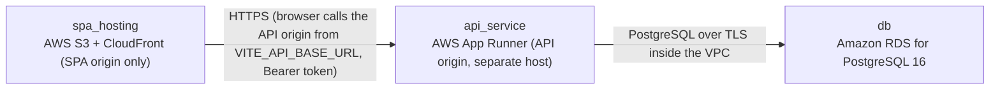

# Deployment Guide

> Maintained by QuorQ AI SDLC. Text between `sdlc:auto` markers is regenerated; anything outside them is yours and is kept.

<!-- sdlc:auto:start how-it-deploys -->
Pushes to `main` run `.github/workflows/deploy.yml`, which builds the API image (if there is a backend) and deploys the SPA to AWS Amplify. Commits touching only `docs/sdlc/**` don't deploy. Deployments can also be started from the platform's Deployment tab.
<!-- sdlc:auto:end how-it-deploys -->

<!-- sdlc:auto:start environments -->
| Name | Service | Runtime | Scaling | Environment |
|---|---|---|---|---|
| spa_hosting | AWS S3 + CloudFront (SPA origin only) | Static React 19 build | Managed CDN | dev |
| api_service | AWS App Runner (API origin, separate host) | Python container running FastAPI 0.115 with uvicorn | 1-2 instances, autoscale on concurrency | dev |
| db | Amazon RDS for PostgreSQL 16 | PostgreSQL 16, db.t4g.micro, encrypted storage | Single-AZ, automated backups | dev |
<!-- sdlc:auto:end environments -->

<!-- sdlc:auto:start live -->
**Frontend URL:** https://p6d4f86f9a0c7.d3j61xaup4zgrx.amplifyapp.com

**Backend URL:** https://52-24-58-20.sslip.io/apps/6d4f86f9a0c7/

**Database:** PostgreSQL · app

**Version:** dae16db50b4d

**Commit:** `dae16db`

**Finished:** 2026-11-10
<!-- sdlc:auto:end live -->

<!-- sdlc:auto:start topology -->

<!-- sdlc:auto:end topology -->
